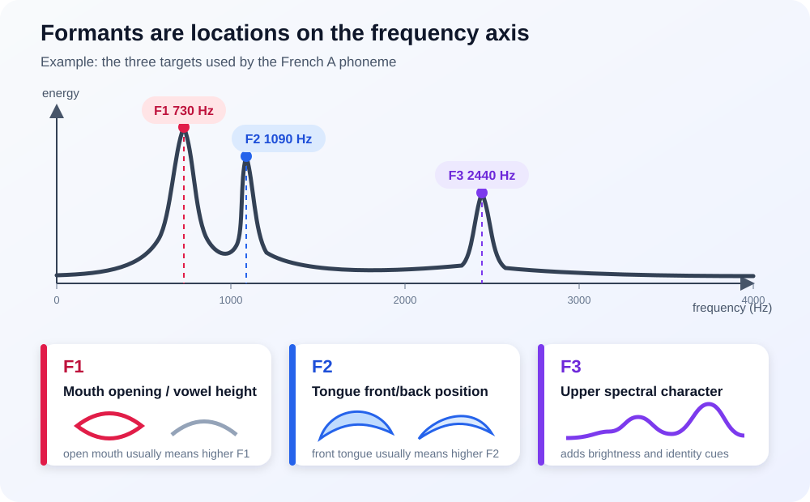
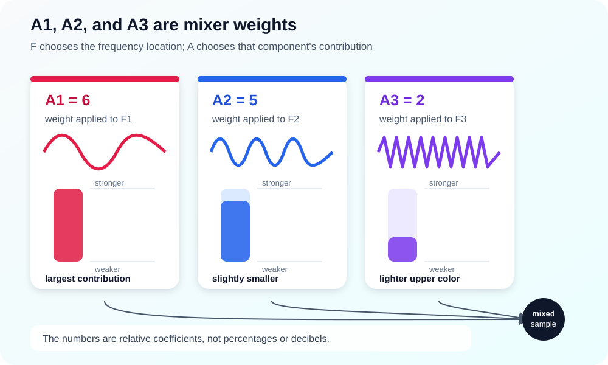
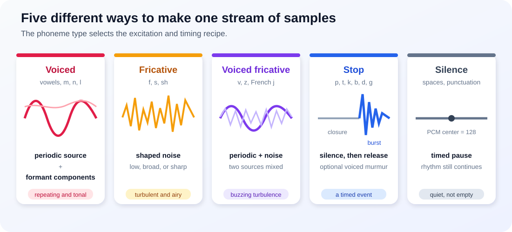
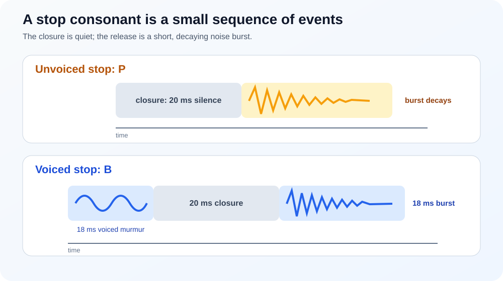
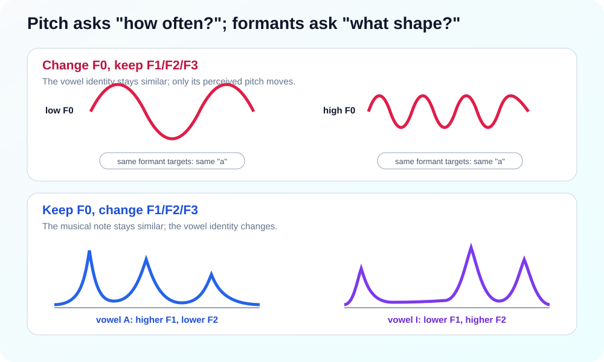
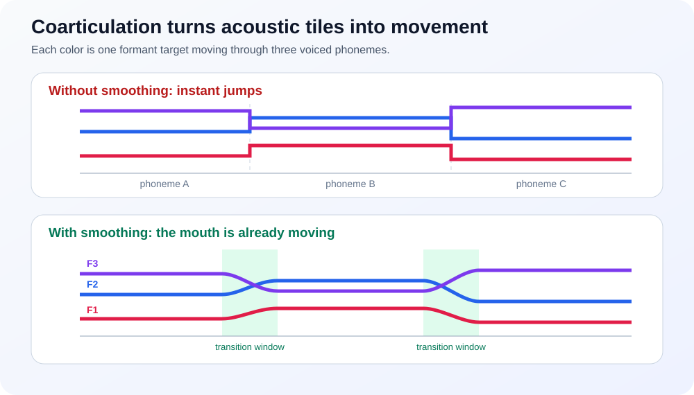
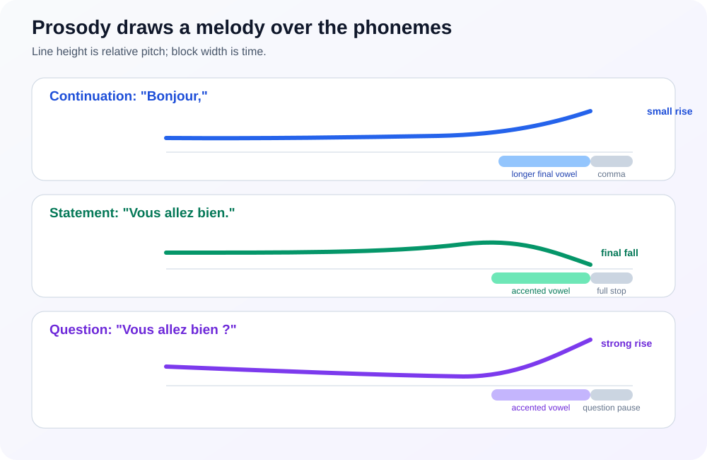
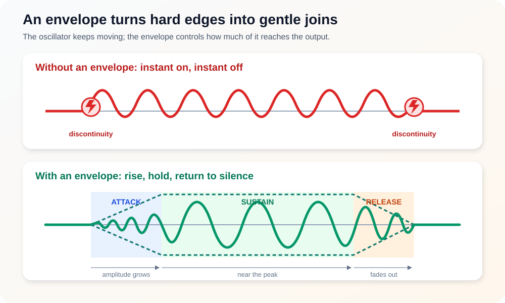

# 2026-10-17 How this tiny Text2Speech synthesizer finds its voice

There is something pleasantly direct about [making a microcontroller speak](./2026-10-08-Building-a-Small-Speech-Synthesizer-in-csharp-on-nanoFramework.md).

Modern text-to-speech systems often involve neural networks, large models, and a fair amount of computing power. This project takes another path: it describes speech with a small collection of frequencies, amplitudes, timings, spelling rules, and noise. Then it turns those descriptions into audio using integer arithmetic.

The result is not trying to impersonate a human. It is trying to remain understandable, predictable, small, and fast on hardware where every allocation and multiplication matters. I find that constraint quite charming 🙂

This article follows one sentence all the way through the system:

```text
written text
    -> normalized text
    -> phonemes
    -> pitch and timing
    -> oscillators and noise
    -> 8-bit PCM samples
    -> a speaker
```

Along the way, we will double-click the compact definitions in [`FrenchPhonemeData`](https://github.com/nanoframework/nanoFramework.IoT.Device/blob/main/devices/Text2Speech/Languages/French/FrenchPhonemeData.cs): what are F1, F2, and F3? Why does a vowel have a pitch? What do A1, A2, and A3 mean? Why is silence also a phoneme? And how do all these little numbers become something we recognize as speech?

## First, the two halves of the system

The synthesizer has two jobs that are deliberately kept separate.

The **language frontend** understands written language. It handles numbers, spelling patterns, silent letters, punctuation, and sentence melody. French and English need different frontends because the same letters do not obey the same rules.

The **renderer** knows almost nothing about language. It receives acoustic instructions such as:

> Make a voiced sound for 125 ms, place its strongest frequency regions around 657 Hz, 1310 Hz, and 2440 Hz, and begin near MIDI note 45.

This separation is important. The renderer does not know that `eau` is usually pronounced like /o/ in French. The French frontend does. Conversely, the frontend does not generate individual audio samples. The renderer does.

In code, [`TtsSynthesizer`](https://github.com/nanoframework/nanoFramework.IoT.Device/blob/main/devices/Text2Speech/Synthesis/TtsSynthesizer.cs) asks the selected frontend to fill a bounded [`TtsPhonemeBuffer`](https://github.com/nanoframework/nanoFramework.IoT.Device/blob/main/devices/Text2Speech/Synthesis/TtsPhonemeBuffer.cs), then asks [`FormantRenderer`](https://github.com/nanoframework/nanoFramework.IoT.Device/blob/main/devices/Text2Speech/Synthesis/FormantRenderer.cs) to render that sequence into an [`IPcmSink`](https://github.com/nanoframework/nanoFramework.IoT.Device/blob/main/devices/Text2Speech/Audio/IPcmSink.cs).

```text
FrenchTtsFrontend.TryPrepare(...)
              |
              v
     TtsPhonemeBuffer
              |
              v
      FormantRenderer
              |
              v
          IPcmSink
```

Keeping this boundary clean makes it possible to add a language without cloning the audio engine.

## A phoneme is not a letter

A **phoneme** is a useful sound unit, not a character.

The word `chat`, for example, should not be rendered as four independent letter sounds. [`FrenchTtsFrontend`](https://github.com/nanoframework/nanoFramework.IoT.Device/blob/main/devices/Text2Speech/Languages/French/FrenchTtsFrontend.cs) recognizes `ch` as a pattern and emits the `Sh` acoustic phoneme. Other patterns are longer:

- `eau` and `eaux` become a close **`o`** (I know, 3 and 4 letters for only 1 phoneme 😄);
- `gn` becomes the palatal sound represented by `Ny`;
- `oi` becomes a `W` glide followed by `A`;
- `an`, `en`, `on`, `in`, and related spellings may become nasal vowels;
- many final consonants disappear;
- punctuation becomes a timed pause.

Rules are tried from specific multi-character patterns down to individual characters. This is a compact grapheme-to-phoneme system: **graphemes** are written forms, while **phonemes** are the sounds selected for rendering.

This distinction explains why a language frontend exists at all. Sending letters directly to an oscillator would mostly produce alphabet soup. Some languages are easier than some others. French is a complex one to render and some shortcuts need to be taken.

## Opening one acoustic definition

Each acoustic recipe becomes a [`TtsPhoneme`](https://github.com/nanoframework/nanoFramework.IoT.Device/blob/main/devices/Text2Speech/Synthesis/TtsPhoneme.cs). Here is the compact helper shape used by the French acoustic table:

```csharp
P(type, f1, f2, f3, a1, a2, a3, pitch, duration, voiced)
```

One current definition for the French vowel `A` is:

```csharp
P(TtsPhonemeType.Voiced, 657, 1310, 2440, 6, 5, 2, 45, 125)
```

That one line is a tiny sound recipe:

| Field | Value | Meaning here |
| --- | ---: | --- |
| `type` | `Voiced` | Use periodic excitation: a repeating vocal-fold-like source |
| `f1` | 657 Hz | First formant frequency |
| `f2` | 1310 Hz | Second formant frequency |
| `f3` | 2440 Hz | Third formant frequency |
| `a1` | 6 | Relative contribution of F1 |
| `a2` | 5 | Relative contribution of F2 |
| `a3` | 2 | Relative contribution of F3 |
| `pitch` | MIDI 45 | Base repetition rate of the voiced source |
| `duration` | 125 ms | Nominal length before speed and local timing changes |
| `voiced` | omitted | Only meaningful for stop consonants; defaults to `false` |

Those values are not a recording. They are a compact model from which a new waveform is generated each time.

Now let us open the box a little further.

## F0 is pitch; F1, F2, and F3 are timbre

This is the most important distinction in the whole synthesizer.

### F0: how fast the voice repeats

When air passes through vibrating vocal folds, it produces a roughly periodic source. Its repetition frequency is called the **fundamental frequency**, or **F0**. We mainly perceive F0 as pitch.

A low F0 sounds low. A high F0 sounds high.

The acoustic table stores pitch as a MIDI note because semitone changes are convenient for intonation. The renderer converts that note through a frequency lookup table. MIDI note 45 is approximately 110 Hz.

Pitch can move while the phoneme identity stays the same. You can sing the vowel `a` on several notes and it remains `a`. That is because vowel identity depends much more on the formants.

### Formants: where the vocal tract reinforces sound

The throat, tongue, mouth, lips, and nasal passages shape the source. Some frequency regions are reinforced more than others. These resonant regions are called **formants**.

In the acoustic model, these targets are stored by the [`F1`](https://github.com/nanoframework/nanoFramework.IoT.Device/blob/main/devices/Text2Speech/Synthesis/TtsPhoneme.cs#L89), [`F2`](https://github.com/nanoframework/nanoFramework.IoT.Device/blob/main/devices/Text2Speech/Synthesis/TtsPhoneme.cs#L95), and [`F3`](https://github.com/nanoframework/nanoFramework.IoT.Device/blob/main/devices/Text2Speech/Synthesis/TtsPhoneme.cs#L101) properties. They are conventionally numbered from low to high:

- **F1** is the first, lowest major resonance;
- **F2** is the second;
- **F3** is the third.

Real speech contains more than three formants and a great deal of fine structure. Three are enough here to capture a recognizable part of a vowel's character at very low cost.



*The three formants are frequency **locations**. In this `A` example, they sit at 657, 1310, and 2440 Hz. The peak heights in this drawing are illustrative; A1, A2, and A3 control their actual contribution in the renderer.*

### What F1 usually tells us

F1 is strongly related to how open the mouth is, or more precisely to vowel height:

- a close vowel such as French `/i/` tends to have a low F1;
- an open vowel such as `/a/` tends to have a higher F1.

Compare the table values:

```text
/i/: F1 about 274 Hz
/a/: F1 about 657 Hz
```

That large difference helps the ear distinguish the close `i` from the open `a`.

This is a relationship, not a magic conversion formula. Formants vary by speaker, anatomy, accent, context, and measurement method.

### What F2 usually tells us

F2 is strongly related to where the tongue constricts the vocal tract:

- front vowels tend to have a high F2;
- back vowels tend to have a lower F2.

For example:

```text
/i/: F2 about 2253 Hz
/u/: F2 about 788 Hz
```

Both are close vowels and therefore both have relatively low F1. Their very different F2 values separate the bright, front `i` from the dark, back, rounded `ou`.

Lip rounding also tends to lower formant frequencies, especially F2. That is part of what makes the French rounded front vowels interesting: /y/, as in `tu`, combines a tongue position somewhat like /i/ with rounded lips. Its F2 sits between a typical /i/ and /u/.

And you can exercise making those sounds and indeed understand the impact of your mouth and tongue on all this.

### What F3 contributes

F3 adds upper spectral character and helps distinguish sounds whose F1 and F2 alone are not quite enough. It contributes to brightness, speaker character, and the identity of some liquids and rhotic sounds.

In this renderer, F3 is intentionally inexpensive. Voiced sounds use sine oscillators for F1 and F2 and a rectangular component for F3. That is not a detailed simulation of a human vocal tract; it is a useful upper-frequency cue.

At an 8 kHz sample rate, the highest representable frequency is 4 kHz. This is the **Nyquist limit**, half the sample rate. The public phoneme model therefore bounds every formant and glide to 0–4000 Hz.

## A small but important honesty: these are not literal filters

Classical speech theory is often explained as a **source-filter model**:

1. vocal folds or turbulent air provide a source;
2. the vocal tract acts as a changing acoustic filter;
3. resonances in that filter create formants.

This project borrows that mental model, but the renderer does not implement three physical resonant filters. For voiced phonemes, it directly generates components at the formant frequencies and synchronizes them to the pitch cycle. It is closer to a lightweight, pitch-synchronous oscillator bank.

That shortcut matters on a microcontroller:

- no floating-point filter coefficients are needed;
- no large voice model is loaded;
- work per sample stays bounded;
- output remains deterministic;
- acoustic values are easy to inspect and tune.

It also explains the synthetic character of the voice. The simplification is not hidden; it is the design. And that is what makes the unique charm of those synthetic voices. They are close to our childhood robot speech on series and cartoons.

## A1, A2, and A3: how much of each ingredient?

For a voiced phoneme, [`A1`](https://github.com/nanoframework/nanoFramework.IoT.Device/blob/main/devices/Text2Speech/Synthesis/TtsPhoneme.cs#L107), [`A2`](https://github.com/nanoframework/nanoFramework.IoT.Device/blob/main/devices/Text2Speech/Synthesis/TtsPhoneme.cs#L113), and [`A3`](https://github.com/nanoframework/nanoFramework.IoT.Device/blob/main/devices/Text2Speech/Synthesis/TtsPhoneme.cs#L119) are relative weights for the three formant components.

If F1, F2, and F3 say **where** energy should appear, A1, A2, and A3 roughly say **how much** each region contributes.



*Using the French `A` values, A1 = 6 gives F1 the largest coefficient, A2 = 5 is slightly smaller, and A3 = 2 adds a lighter upper component. The waves have different frequencies; the vertical bars visualize their relative weights.*

They are not decibels and should not be read as percentages. They are compact integer coefficients used by the mix. Doubling one value increases that component's numerical contribution, but the final perceived loudness also depends on the waveform, envelope, other components, clipping, and human hearing.

There is one easy-to-miss detail: these fields are reused by different renderer paths.

| Phoneme type | `A1` | `A2` | `A3` |
| --- | --- | --- | --- |
| `Voiced` | F1 weight | F2 weight | F3 weight |
| `Fricative` | Noise-shaping mode | Noise level | Unused |
| `Stop` | Burst noise-shaping mode | Burst level | Unused |
| `VoicedFricative` | Voiced/formant weight | Noise weight | Noise-shaping mode |
| `Silence` | Unused | Unused | Unused |

So the names describe three compact renderer parameters, but their exact role depends on [`TtsPhonemeType`](https://github.com/nanoframework/nanoFramework.IoT.Device/blob/main/devices/Text2Speech/Synthesis/TtsPhonemeType.cs). Reading the type first avoids a lot of confusion.

## Five kinds of sound

Speech is not made of vowels alone. The renderer has five paths.



*Every path ends as the same unsigned 8-bit PCM stream, but each begins with a different physical idea: vibration, turbulence, both together, a release event, or a pause.*

### 1. Voiced sounds

Vowels and sonorant consonants such as `m`, `n`, `l`, and glides use periodic excitation. The renderer:

1. finds the pitch frequency;
2. advances a pitch phase;
3. advances F1, F2, and F3 phases;
4. resets the formant phases at each new pitch cycle;
5. mixes the weighted formant waveforms;
6. applies an attack and release envelope.

Resetting the formant phases when the pitch period wraps gives the sound a repeating voiced structure. The formant frequencies color that repetition.

### 2. Fricatives

Sounds such as `f`, `s`, and `sh` come from turbulent airflow. A periodic source would be the wrong ingredient, so the renderer generates deterministic pseudo-random noise with a linear-feedback shift register.

The noise can be shaped in three cheap ways:

- low-pass-like for darker turbulence;
- unfiltered for broad noise;
- difference/high-pass-like for sharper hiss.

That helps separate, for example, a softer `f` from a brighter `s`.

### 3. Voiced fricatives

Sounds such as `v`, `z`, and French `j` as in *jour* need both ingredients:

- periodic energy because the vocal folds vibrate;
- noisy energy because air is forced through a constriction.

The renderer generates and mixes both. This is a lovely example of speech being neither purely a tone nor purely noise.

### 4. Stops

Stops such as `p`, `t`, `k`, `b`, `d`, and `g` are events rather than steady sounds. They have phases:

1. the airflow closes;
2. pressure builds;
3. the closure is released as a short burst.

The renderer represents that with silence followed by a decaying noise burst. Voiced stops also receive a short low voiced murmur before the closure. That small cue helps distinguish `b` from `p`, `d` from `t`, and `g` from `k`.



*An unvoiced stop is closure plus a decaying burst. A voiced stop adds a brief periodic murmur before the closure; in the current renderer, its burst is also kept short and bounded.*

### 5. Silence

Silence is not an absence of design. It carries rhythm.

French acoustic data defines different nominal pauses:

- a space: 25 ms;
- a comma: 220 ms;
- a clause boundary such as `;` or `:`: 320 ms;
- a full stop: 400 ms;
- a question mark: 500 ms.

The exact output is also affected by speaking speed. Treating punctuation as phonemes makes timing part of the same bounded sequence as every other sound. And it makes everything simpler and more efficient!

## Pitch, formants, and voice size are different controls

It is tempting to move every frequency together, but the controls represent different ideas.



*The top row changes how quickly the voiced pattern repeats. The bottom row changes where spectral energy gathers. One mainly changes the note; the other changes the mouth shape we hear.*

These six controls are defined together by [`VoiceOptions`](https://github.com/nanoframework/nanoFramework.IoT.Device/blob/main/devices/Text2Speech/Synthesis/VoiceOptions.cs).

### [`PitchShift`](https://github.com/nanoframework/nanoFramework.IoT.Device/blob/main/devices/Text2Speech/Synthesis/VoiceOptions.cs#L61)

Pitch shift moves F0 in semitones. It changes how high or low the periodic voice sounds without directly changing the vowel targets.

### [`FormantScalePercent`](https://github.com/nanoframework/nanoFramework.IoT.Device/blob/main/devices/Text2Speech/Synthesis/VoiceOptions.cs#L71)

Formant scale moves F1, F2, and F3 together. It approximates changing vocal-tract size. Shorter vocal tracts generally have higher resonances; longer vocal tracts have lower ones.

This changes voice character without directly changing the musical pitch. Modest values are useful. Extreme scaling would also move vowels away from the regions that identify them, which is why the public range is bounded to 80–120%.

### [`IntonationPercent`](https://github.com/nanoframework/nanoFramework.IoT.Device/blob/main/devices/Text2Speech/Synthesis/VoiceOptions.cs#L76)

The frontend assigns relative pitch offsets across a phrase. Intonation strength scales those offsets:

- 0% flattens the sentence contour;
- 100% keeps the normal contour;
- 200% exaggerates it.

### [`SpeedPercent`](https://github.com/nanoframework/nanoFramework.IoT.Device/blob/main/devices/Text2Speech/Synthesis/VoiceOptions.cs#L66)

Speed changes the conversion from milliseconds to samples. A higher percentage produces fewer samples per phoneme and therefore faster speech.

### [`FricativeNoisePercent`](https://github.com/nanoframework/nanoFramework.IoT.Device/blob/main/devices/Text2Speech/Synthesis/VoiceOptions.cs#L81)

This scales turbulent noise in fricatives and stop bursts. It can soften or emphasize consonant edges.

### [`TransitionSmoothingPercent`](https://github.com/nanoframework/nanoFramework.IoT.Device/blob/main/devices/Text2Speech/Synthesis/VoiceOptions.cs#L86)

This controls how long voiced formants lean toward their neighbors. It is one of the ingredients that turns a phoneme list into something closer to connected speech.

## Speech is movement, not a row of frozen vowels

Suppose the renderer played every vowel with fixed formants, stopped, and then jumped to the next one. The sequence might be understandable, but it would sound like acoustic tiles placed side by side.

Real articulation moves continuously. The tongue is already leaving one shape while the next sound is approaching. This influence between neighboring sounds is called **coarticulation**.



*Without smoothing, each target begins as an abrupt step. With smoothing, the formants bend during short transition windows because the articulators are already travelling toward the next sound.*

The renderer approximates it in two ways.

First, it looks backward and forward for neighboring voiced phonemes. Near a boundary, it interpolates the current formant frequencies from the previous voiced target and toward the next one. The default transition window is based on 200 samples, or 25 ms at 8 kHz, and [`TransitionSmoothingPercent`](https://github.com/nanoframework/nanoFramework.IoT.Device/blob/main/devices/Text2Speech/Synthesis/VoiceOptions.cs#L86) scales it.

Second, a phoneme may define explicit [`Glide1`](https://github.com/nanoframework/nanoFramework.IoT.Device/blob/main/devices/Text2Speech/Synthesis/TtsPhoneme.cs#L143), [`Glide2`](https://github.com/nanoframework/nanoFramework.IoT.Device/blob/main/devices/Text2Speech/Synthesis/TtsPhoneme.cs#L149), and [`Glide3`](https://github.com/nanoframework/nanoFramework.IoT.Device/blob/main/devices/Text2Speech/Synthesis/TtsPhoneme.cs#L155) targets. During that phoneme, its formants move toward those targets. This is useful for diphthong-like motion where the sound itself changes shape.

Neighbor smoothing and explicit glides answer related but different questions:

- **smoothing:** how do adjacent sounds meet?
- **glide:** how does this sound evolve internally?

The current French table uses fixed targets, but the model already has room for glides.

## Prosody: the melody and rhythm above the phonemes

Correct phonemes can still sound wrong if timing and melody are flat.

The French frontend divides text into accentual groups using punctuation. Within each group, it counts letters, finds the final suitable vowel for accent, and assigns compact pitch movements:

- a continuation tends to rise slightly near its end;
- a final declarative group rises a little and then falls;
- a final question falls slightly at first and rises more strongly at the end.



*Pitch supplies the melodic line, duration widens the accented vowel, and punctuation contributes the gray pause. Prosody is the coordination of all three rather than pitch alone.*

The final accented vowel is lengthened. The frontend stores both the pitch offset and a local duration percentage beside each phoneme in [`TtsPhonemeBuffer`](https://github.com/nanoframework/nanoFramework.IoT.Device/blob/main/devices/Text2Speech/Synthesis/TtsPhonemeBuffer.cs).

This model is deliberately modest. It does not parse syntax, infer emotion, or understand the speaker's intention. Still, a few well-placed changes often contribute more to intelligibility and familiarity than adding another oscillator.

There is a nice engineering story behind it too: host-side tools can study richer speech data and prosody models, while the embedded runtime keeps only small deterministic rules. The expensive investigation happens on a development machine; the device gets the distilled result.

## Nasal vowels and the missing anti-formants

French nasal vowels deserve a special note.

Opening the nasal passage adds resonances, but it can also introduce **anti-formants**: frequency regions where energy is cancelled. A detailed nasal model therefore needs more than moving three positive peaks.

The current renderer has no anti-formant path. French nasal vowels are approximated with selected F1/F2/F3 targets and reduced upper-formant amplitudes. That preserves the one renderer architecture and remains cheap, but it is an approximation.

This is a good example of an honest embedded compromise: model the cue that buys useful intelligibility, document the cue that is missing, and avoid pretending the approximation is complete.

## From milliseconds to samples

The output format is:

- 8,000 samples per second;
- one channel;
- unsigned 8-bit PCM.

At 8 kHz, one sample lasts 0.125 ms. A nominal 125 ms vowel at normal speed therefore occupies about:

```text
125 ms × 8000 samples/s ÷ 1000 = 1000 samples
```

Local duration and global speed are included in the actual calculation:

```text
samples =
    milliseconds × 8000 × localDurationPercent
    ------------------------------------------------
              1000 × speedPercent
```

The implementation rounds with integers and ensures that a positive duration produces at least one sample.

Unsigned 8-bit PCM places silence at 128:

```text
0       strongest negative sample
128     silence / center
255     strongest positive sample
```

The renderer calculates signed values around zero, clamps them to roughly -127…127, then adds 128 before writing each byte.

Eight thousand bytes represent about one second of audio. That compactness is useful for RAM, storage, I/O, and streaming, though it naturally limits high-frequency detail.

## The inner rendering loop, slowly

The renderer uses a 24-bit phase accumulator for each oscillator. We can think of phase as a hand moving around a circle.

For every sample:

1. add a frequency-dependent increment to the phase;
2. keep the low 24 bits so the phase wraps around;
3. use the upper bits as an index into a 256-entry sine table;
4. multiply by a small integer amplitude;
5. combine the components;
6. apply the amplitude envelope;
7. clamp and write one PCM byte.

A higher frequency has a larger phase increment, so its hand travels around the circle more times per second.

The phase increment is approximately:

```text
frequency × 2^24 / 8000
```

The code uses the precomputed integer factor 2097, which is the rounded value of `2^24 / 8000`. No floating-point division is needed per sample.

Pitch, formant transitions, and envelopes do not need to be recalculated at the full sample rate. Their control values are updated every four samples: 2,000 times per second. Oscillator phase and noise still run at 8,000 samples per second. This split saves work while keeping control movement much faster than the ear needs for these contours.

The renderer also writes through a reusable 2 KB buffer. That keeps streaming practical and avoids allocating a new object for every tiny piece of audio. Allocation is also bad, reusing is best!

## Envelopes keep edges under control

Starting a waveform instantly at full amplitude creates a discontinuity, often heard as a click. Ending it abruptly creates another.



*The dashed outline is the envelope; the green carrier is the sound being scaled. During attack the permitted amplitude grows, sustain keeps it near the peak, and release brings it back to the PCM center without a hard edge.*

Each sustained sound therefore receives an **envelope**:

- attack: rise from silence;
- sustain: remain near the peak;
- release: fall back toward silence.

Voiced, fricative, and voiced-fricative paths use slightly different attack and release proportions. Stops use their own closure-and-burst structure.

An envelope is simple, but without it the joins would advertise every implementation detail to our ears.

## Why the implementation is integer-only

On a desktop, replacing these calculations with floating point would be easy. The target here is a constrained .NET nanoFramework device, where predictable integer work is often a better trade.

The renderer uses:

- lookup tables for sine and MIDI pitch;
- fixed-point positions for interpolation;
- shifts instead of many divisions;
- a small deterministic noise generator;
- reusable buffers;
- bounded text and phoneme capacities.

The fixed phoneme buffer holds at most 128 entries. If a frontend cannot fit the complete result, it returns failure rather than silently truncating speech. [`TtsSegmenter`](https://github.com/nanoframework/nanoFramework.IoT.Device/blob/main/devices/Text2Speech/Synthesis/TtsSegmenter.cs) handles longer input by preferring sentence boundaries, then word boundaries, and retrying smaller pieces when necessary.

Bounded behavior is part of correctness here, not merely optimization.

## Following a French phrase end to end

Consider:

```text
Bonjour, comment allez-vous ?
```

The exact sequence depends on the spelling rules, but the journey looks like this:

1. **Normalization** lowercases and expands supported numbers into words.
2. **Grouping** finds the comma and question mark as prosodic boundaries.
3. **Spelling rules** recognize patterns such as `on`, `ou`, and silent finals.
4. **Phoneme selection** appends references to acoustic definitions such as nasal vowels, fricatives, stops, and glides.
5. **Prosody** attaches small semitone offsets and lengthens an accented vowel.
6. **Punctuation** appends explicit silence phonemes.
7. **Rendering** selects the voiced, noisy, stop, mixed, or silence path for each entry.
8. **Transitions** move voiced formants toward neighboring targets.
9. **Sampling** produces unsigned 8-bit PCM at 8 kHz.
10. **Output** collects the bytes in memory, writes a WAV file, or streams blocks toward I2S playback.

No stage owns the whole act of speaking. Intelligibility emerges from the agreement between all of them.

## Where the acoustic numbers come from

Formant targets should not be treated as universal constants.

People have different vocal tracts. Formants vary with sex, age, accent, speaking style, neighboring phonemes, and even the part of a vowel being measured. Mixing unrelated speakers into one average can create a voice that belongs to nobody.

The repository does not include a host-side French acoustic calibration workflow. It aligns native recordings to phonemes, measures stable F1/F2/F3 windows with linear predictive coding, rejects unstable measurements, and summarizes robust candidates. Those reports are evidence for a human tuning decision, not automatic source changes.

That last step matters. A statistically central value is not guaranteed to sound best in a simplified oscillator renderer. Measurement narrows the search; listening and regression testing finish it. I had to listen to a lot of different sentences both in French and in English to improve the quality. And the problem can reside in any part of the flow.

This is also why a table may evolve over time. Changing `A` from one plausible F1/F2 pair to another is not necessarily correcting a typo. It may be recalibrating a deliberately simplified voice.

## And what changes when the language is English?

Almost everything described above still applies. English uses the same [`TtsPhoneme`](https://github.com/nanoframework/nanoFramework.IoT.Device/blob/main/devices/Text2Speech/Synthesis/TtsPhoneme.cs), the same five sound types, the same formant renderer, and the same PCM output. The difference is mostly **before** rendering: another language needs another path from spelling to acoustic recipes.

It helps to compare the two frontends without explaining the whole synthesizer again:

| Question | French frontend | English frontend |
| --- | --- | --- |
| How is spelling parsed? | Contextual rules handle accents, nasal spellings, silent finals, function words, and combinations such as `eau`, `gn`, and `oi`. | Ordered [`Pattern`](https://github.com/nanoframework/nanoFramework.IoT.Device/blob/main/devices/Text2Speech/Languages/English/Pattern.cs) entries handle combinations such as `eigh`, `tion`, `igh`, `th`, and `oo`, followed by rules for silent `e`, soft `c`, final `y`, doubled letters, and a small set of irregular words. |
| Which vowels need special attention? | Oral, rounded, and nasal vowels carry much of the language's identity: `u` is not `ou`, and `an` is not simply `a` followed by `n`. | Long and short vowels, schwa, rhotic vowels such as `er`, and moving diphthongs such as the vowels in *day*, *eye*, *boy*, and *now* matter more. |
| How is vowel movement represented? | The current French table mostly uses fixed formant targets and sometimes emits separate glide-plus-vowel phonemes, as `oi` does with `W` followed by `A`. | Several English diphthongs directly use `Glide1`, `Glide2`, and `Glide3`, so one phoneme moves from its starting formants toward a second vowel shape. |
| How is prosody applied? | Accentual groups follow punctuation. Their final suitable vowel can be lengthened, continuations rise, statements fall, and questions rise at the end. | One compact contour runs across the letters of the complete utterance: statements rise and then fall, while questions begin slightly lower and rise through their second half. |
| How are numbers expanded? | Cardinal integers are expanded as French numbers through 999,999,999. | A two-digit run is read as a number; runs of other lengths are spoken digit by digit. |
| How long are the default pauses? | Space 25 ms, comma 220 ms, clause 320 ms, full stop 400 ms, question 500 ms. | Space 80 ms, comma 120 ms, and every sentence ending 160 ms. A question differs through pitch, not through a longer question-mark pause. |

The spelling difference is especially important. French orthography is not simple, but many recurring contexts can be expressed with rules such as “this vowel pair is nasal before this kind of boundary.” English spelling has accumulated pronunciations from several histories, so the compact [`EnglishTtsFrontend`](https://github.com/nanoframework/nanoFramework.IoT.Device/blob/main/devices/Text2Speech/Languages/English/EnglishTtsFrontend.cs) leans more heavily on an ordered pattern table, a few whole-word exceptions, and a per-letter fallback.

That fallback keeps the frontend small and ensures that unfamiliar words still produce sound, but it is not a pronunciation dictionary. Words that share a spelling fragment do not always share its pronunciation—English rather enjoys doing that to us 🙂 The rules aim for useful embedded speech, not complete coverage of every accent and exception.

The acoustic inventory changes too. English [`PhonemeData`](https://github.com/nanoframework/nanoFramework.IoT.Device/blob/main/devices/Text2Speech/Languages/English/PhonemeData.cs) includes explicit rhotic vowels with a lowered F3 cue, a neutral schwa, and several long vowels and diphthongs with internal formant glides. French [`FrenchPhonemeData`](https://github.com/nanoframework/nanoFramework.IoT.Device/blob/main/devices/Text2Speech/Languages/French/FrenchPhonemeData.cs) instead spends more of its compact inventory on close/open vowel pairs, front rounded vowels, and four approximate nasal vowels.

English timing is simpler in the current implementation. Its frontend adds pitch offsets but uses the nominal duration stored in each phoneme; it does not apply the French frontend's local accent-lengthening percentage. Long English vowels and diphthongs are already given longer nominal durations in their acoustic definitions.

These are implementation choices, not claims that English has no accentual groups or that every French speaker uses one melody. Both frontends are small deterministic sketches of their languages. They share the same pencil; they choose different lines.

## What this synthesizer models well, and what it leaves out

It models:

- language-specific spelling-to-sound rules;
- three formant targets and amplitudes;
- pitch and basic sentence intonation;
- durations, accent lengthening, and punctuation pauses;
- periodic, noisy, mixed, stop, and silent sound categories;
- simple coarticulation and optional internal glides;
- bounded, streaming-friendly PCM generation.

It does not model:

- a physical vocal tract;
- learned speaker identity;
- arbitrary emotional delivery;
- detailed breath, aspiration, or vocal-fold behavior;
- anti-formants for nasal sounds;
- more than three explicit formant components;
- syntax- or meaning-aware prosody;
- the full high-frequency spectrum of natural speech.

These are not accidental omissions. They describe the boundary that lets the system fit its target.

## A practical tuning order

When a sound is wrong, changing every number at once makes listening tests nearly useless. A calmer order is:

1. **Check the frontend.** Did the spelling produce the intended phoneme?
2. **Check the category.** Should the sound be voiced, noisy, mixed, a stop, or silence?
3. **Tune F1 and F2.** They carry most vowel identity.
4. **Tune duration.** A correct spectrum with wrong timing can still sound like the wrong phoneme.
5. **Tune amplitudes and F3.** Refine brightness and balance.
6. **Tune transitions.** Listen in words, not only in isolation.
7. **Tune pitch and prosody.** Judge complete phrases.
8. **Test on the real speaker.** A tiny loudspeaker and enclosure color sound too.

For comparisons, change one variable, synthesize the same phrase, and listen at matched playback volume. Human loudness perception can otherwise make `louder` seem `better` remarkably quickly 😉

## How much space does the complete voice take?

The most useful size is not the downloaded NuGet archive. A package also carries desktop DLLs, symbols, XML documentation, a README, the license, and the icon. On a nanoFramework device, the interesting files are the compiled `.pe` deployment images referenced by the package manifests.

Measured from the current Release artifacts used by the NuGet packages:

| Deployment image | Exact size | Size in KiB | What it contains |
| --- | ---: | ---: | --- |
| `Iot.Device.Text2Speech.pe` | 12,772 bytes | 12.47 KiB | Synthesizer, renderer, oscillators, noise generation, transitions, bounded buffers, segmentation, PCM sinks, and WAV support |
| `Iot.Device.Text2Speech.English.pe` | 6,036 bytes | 5.89 KiB | English number expansion, spelling patterns, exceptions, pronunciation rules, and all English acoustic definitions |
| `Iot.Device.Text2Speech.French.pe` | 8,712 bytes | 8.51 KiB | French number expansion, contextual pronunciation, prosody rules, and all French acoustic definitions |

Each language NuGet is standalone and includes the shared core plus its language assembly. The deployed Text2Speech totals are therefore:

| Installed capability | Unique `.pe` payload |
| --- | ---: |
| Core only, for a custom language frontend | 12,772 bytes / 12.47 KiB |
| English | 18,808 bytes / 18.37 KiB |
| French | 21,484 bytes / 20.98 KiB |
| English and French together | 27,520 bytes / 26.88 KiB |

That last number includes the engine, both spelling systems, both number systems, both acoustic inventories, and both prosody strategies. There are no recorded fragments, model weights, external dictionaries, or voice-data files waiting beside it.

For scale, one second of the generated unsigned 8-bit, 8 kHz mono PCM occupies 8,000 bytes. **The entire bilingual TTS implementation is therefore smaller than three and a half seconds of its own uncompressed output audio**. The engine stays resident and keeps generating new speech; the waveform does not have to be stored in advance. That is where the formant approach earns its keep 🙂

These figures describe managed deployment flash, not the complete firmware or peak runtime RAM. The nanoFramework runtime and application dependencies are separate, while phoneme workspaces, the renderer's 2 KB output block, optional full utterance buffers, and playback queues consume RAM while running. Exact `.pe` sizes can also move as code and compiler versions change, so the byte counts are a measured snapshot rather than a permanent package guarantee.

## The whole idea in one sentence

This Text2Speech engine converts writing into a timed sequence of small acoustic recipes, then combines pitch-synchronous formant components, shaped noise, silence, and smooth movement to produce compact PCM audio.

Or, less formally:

> the frontend chooses the mouth shapes; the renderer wiggles the numbers; the speaker wiggles the air.

That is the entire path—and also enough moving parts to keep us happily listening, measuring, and adjusting for quite a while.
