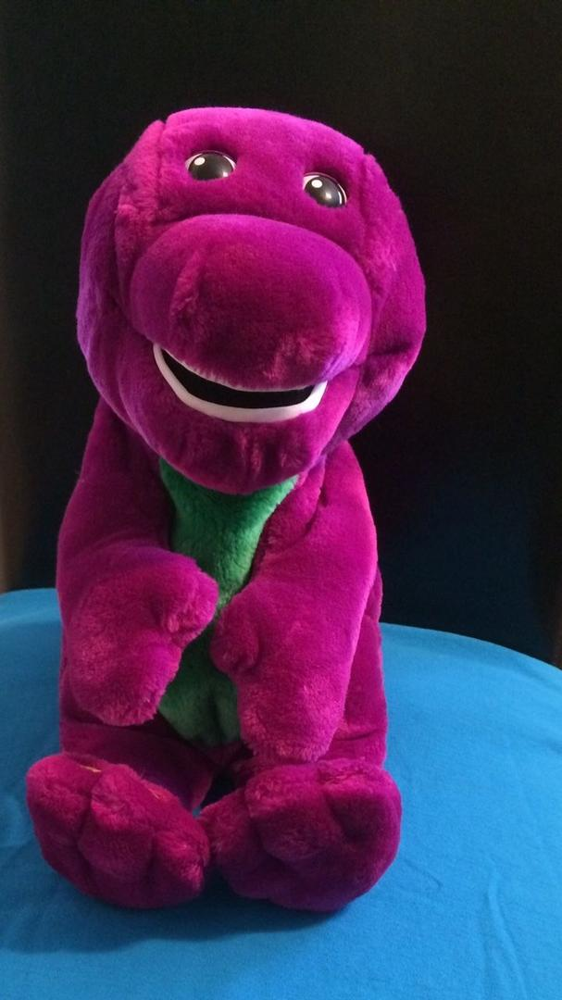
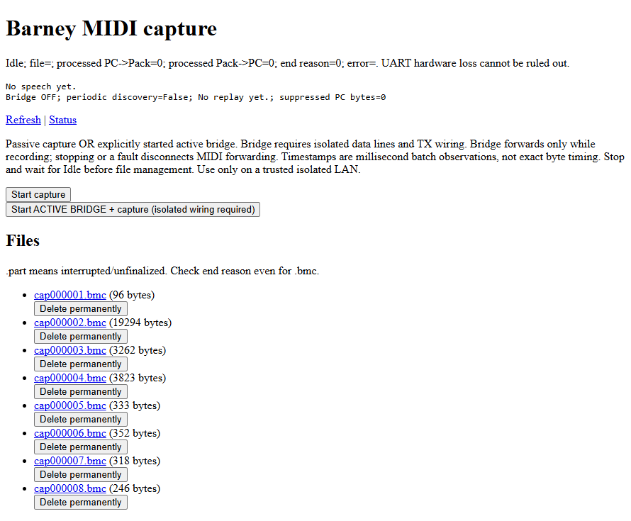

# Bringing Microsoft's ActiMates Barney Back to Life - Part 1: Listening Before Talking

Some projects start with a business requirement. This one started with a purple dinosaur. 🦖

I have a [Microsoft ActiMates Barney](https://news.microsoft.com/source/1997/02/07/microsoft-launches-actimates-early-learning-system-at-toy-fair/): a toy from the late 1990s that could interact with compatible PC games through a wireless link. That link takes you to Microsoft's original announcement from February 1997 - a little time capsule before we open the toolbox. The computer connected to a little transmitter called the **PC Pack**, and the Pack communicated with Barney.

Barney was not alone in the [ActiMates family](https://en.wikipedia.org/wiki/ActiMates): **Arthur and his sister D.W.** joined in 1998, followed by the four **Teletubbies - Tinky Winky, Dipsy, Laa-Laa and Po -** in 1999. Seven characters in total: enough for a small plush support group. The Teletubbies supported TV interaction rather than the PC connection explored here, so this series focuses on Barney without assuming every model speaks the same protocol (while no reason it should not!).



My goal? Give him a second life, understand the protocol, and eventually control him with modern hardware.

Naturally, the first challenge was discovering that I had misidentified the connector.

## That is not a parallel port 🔌

I initially remembered the Pack as something you plugged into a parallel port. It is actually a **two-row, 15-pin [MIDI/game-port connector](https://en.wikipedia.org/wiki/Game_port)**, technically called [DA-15](https://en.wikipedia.org/wiki/D-subminiature).

Not a printer port. Not VGA either, despite the shared enthusiasm for having 15 pins.

That distinction matters: a connector's shape does not tell you how to talk to the device.


The system looks like this:

```text
PC and original game
        |
        | Wired MIDI/game-port connection
        |
Original PC Pack
        |
        | Wireless connection
        |
      Barney
```

There are therefore **two protocols to investigate**: the wired conversation between PC and Pack, and the wireless conversation between Pack and toy.

For this first stage, I kept the original Pack and concentrated on the cable. **One mystery at a time**.

## Start with something that already works

The most useful piece of equipment was not particularly modern: **an old PC with a working MIDI-capable game port**. Good news is I have a collection of few, still working old PCs from 8088 IBM Compatible PC to Pentium Bi Pro running a Windows XP. I used that last one for the tests.

With the original software running and Barney responding, I had a known-good reference. Instead of inventing commands and hoping the dinosaur appreciated my creativity, I could record what the real software sent.

The original software was useful in another way too. Inspecting its communication routines gave me clues about discovery messages and data encoding. That created a useful feedback loop:

> Read the software, predict a message, then check whether the hardware actually sends it.

A prediction is helpful. A matching capture is much better.

## What equipment do we need? 🧰

For our wired investigation, the essentials were:

| Item | Purpose |
| --- | --- |
| Barney and the original PC Pack | The system we want to understand |
| Working PC, MIDI/game port and original software | Generate real conversations |
| Straight-through DA-15 breakout or accessible extension | Reach the signals without cutting the original cable |
| [ESP32-S3](https://www.espressif.com/en/products/socs/esp32-s3) with two available hardware [UARTs](https://en.wikipedia.org/wiki/Universal_asynchronous_receiver-transmitter) | Record both directions |
| Suitable voltage interfaces | Protect the ESP32 and avoid disturbing communication |
| Multimeter | Check continuity, grounds and supplies, yes, it's been really useful! |
| Modern development PC | Build the recorder and analyse captures |
| USB Stick | While networking still working on XP, it won't connect to a recent SMB share 😉 |

A scope or logic analyser is also valuable, particularly when checking signal quality.

One shopping trap: a **USB joystick adapter is not automatically a MIDI interface**. Having the right-shaped socket does not mean it carries the signals we need. And you have to check this in the Hardware properties under the Audio entry.

## Why an ESP32 rather than another tool?

We considered several routes.

A **[logic analyser](https://en.wikipedia.org/wiki/Logic_analyzer)** is excellent for examining individual transitions and checking serial decoding. It is especially useful when the electrical side is uncertain.

A **software-only tool on the old PC** can communicate through its MIDI driver. We eventually built that too, but it does not independently show everything happening on the cable.

A **USB serial adapter** might help with individual experiments, provided its baud-rate support and electrical interface are suitable. An ordinary RS-232 adapter is not something to connect directly here.

We chose an **ESP32-S3 running [.NET nanoFramework](https://nanoframework.net/)** for the recorder: two hardware serial receivers, C#, local storage and Wi-Fi in one inexpensive board. Yes, also obviouly because I'm one of the main .NET nanoFramework maintainer. And also I 💘 C#.

The Wi-Fi part was mostly convenience. Downloading captures through a browser beats repeatedly moving files around like it is, well, 1997.

## Listen to both sides - without interrupting

The important design choice was to build a **passive tap**, not a bridge.

```text
PC ================================ PC Pack
              |
              +-- PC to Pack signal --> receiver 1
              |
              +-- Pack to PC signal --> receiver 2
```

The original connection stays intact. The ESP32 listens, but does not forward the conversation or inject bytes.

On this MIDI/game-port interface, the [pin assignments](https://allpinouts.org/pinouts/connectors/input_device/pc-midi-game-port/) are:

- **Pin 12:** PC MIDI output, travelling toward the Pack.
- **Pin 15:** MIDI input to the PC, coming from the Pack.
- **Pins 4 and 5:** standard ground connections, checked against the actual cable.

Connector diagrams deserve particular suspicion: the solder-side view is mirrored relative to the mating face. Verify continuity with power disconnected.

```text
                  WIDE SIDE / TOP
          _________________________________________
         /                                         \
        |   8    7    6    5    4    3    2    1    |
        |     15   14   13   12   11   10    9      |
         \_________________________________________/
                 NARROW SIDE / BOTTOM

        12 = MIDI OUT from PC -> HV1 -> LV1 -> GPIO4
        15 = MIDI IN to PC    -> HV2 -> LV2 -> GPIO5
         4, 5    = GND
         1, 8, 9 = +5 V supply: verify each before using as HV reference
```

And leave the ESP32's transmit pins **physically disconnected**. Two devices trying to drive the same wire is not a productive conversation. Yes, I tried 😀.

## A quick electrical reality check ⚠️

The ESP32 uses **3.3 V GPIO and is not 5 V tolerant**. These game-port signals must not simply be wired straight into it.

We had a BSS138 [level-shifter](https://en.wikipedia.org/wiki/Logic_level_shifter) board available for prototyping, but these common modules are not ideal measurement probes. Their pull-ups can load the signals and affect edge speed. Suitable high-impedance receive buffers are preferable. Here, we're speaking about 31,250 baud, so relatively slow.

Measure first, choose the interface accordingly, and check that adding the recorder does not stop the original system working.

Also, do not casually join the PC's 5 V supply to the ESP32's USB power rail. Barney needs a comeback, not a smoke machine.

## The first useful bytes

The wired transport uses standard [MIDI](https://en.wikipedia.org/wiki/MIDI) serial timing:

```text
31,250 baud
8 data bits
No parity
1 stop bit
```

Our recorder saves both directions, with timing and direction labels, to the ESP32's internal flash. A small web interface starts and stops recordings and downloads the files.



*The capture page running on the ESP32. For our passive tap, use **Start capture**, not the active-bridge button - that requires different wiring. And, yes, I know, I'm not a designer 😀*

Early captures contained plenty of bytes, but little trustworthy information. That was a useful lesson: **a valid capture file is not proof of valid captured data**.

Eventually, we saw this discovery request:

```text
PC -> Pack:
F0 00 01 0A 11 0A F7
```

And inside the reply (as string in the payload):

```text
Cleo V1.5 (c) Microsoft 1996.All rights reserved.
```

After staring at corrupted data, a readable identification string feels surprisingly exciting. 🎉

It proved we were receiving a meaningful conversation with the **Pack**. It did not yet prove that we could acquire Barney or make him speak.

But the dinosaur investigation finally had a reliable starting point.

## Next: understanding the conversation 🔍

With the capture setup working, the next step is to separate discovery, connection setup and actual commands - and understand why MIDI traffic does not necessarily mean musical notes.

Wireless comes later. First, we need to understand what the computer was asking the little blue box to do.

In a second post, we'll turn those captured bytes into messages, uncover the connection handshake, and discover why replaying yesterday's conversation is not quite enough.
