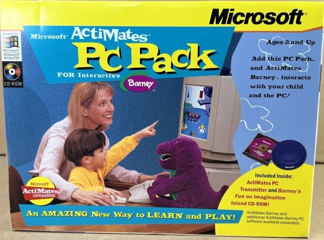

# Bringing Microsoft's ActiMates Barney Back to Life - Part 2: Making Sense of Dinosaur Bytes

In the [first post](./2026-11-10-Hacking-Microsoft-Barney-part1.md), I connected an ESP32 to the original PC Pack and finally captured a readable identification:

```text
Cleo V1.5 (c) Microsoft 1996.All rights reserved.
```

Very satisfying. Also, not quite the same as making Barney do anything. The round blue box had introduced itself; the dinosaur had not signed up for the conversation yet. 🦖

Time to understand what those bytes actually meant.

## Two sources of truth 🔍

There were two main ways forward: study recordings and look for patterns, or inspect the original software to understand how it built its messages.

I used both.

The original game's [DLLs](https://en.wikipedia.org/wiki/Dynamic-link_library) - shared libraries containing compiled code and still held the communication routines. In particular, `TOYAPI.DLL` and `TOY7TH.R32` gave me a trail to follow. No original source code. That would have been a suspiciously convenient twist.

Using a [disassembler](https://en.wikipedia.org/wiki/Disassembler), which turns machine instructions into something a human can inspect, I followed how the software sent commands and processed replies. Small C# tools helped inspect the binaries and decode the recordings. Did I say I 💘 C#?.

The rule stayed simple:

> A plausible explanation is a theory. A matching capture is evidence.

## MIDI, but not a piano 🎹

The cable carries [MIDI](https://en.wikipedia.org/wiki/MIDI), but Barney is not waiting for a keyboard solo.



MIDI provides the transport and message structure. Microsoft's software uses it to carry its own commands.

Discovery starts with a fairly recognisable exchange:

```text
PC -> Pack: FF
            wait 50 milliseconds
PC -> Pack: F0 00 01 0A 11 0A F7
Pack -> PC: F0 00 01 0A 11 0A [identification text] F7
```

All byte values here are [hexadecimal](https://en.wikipedia.org/wiki/Hexadecimal). `FF` is MIDI System Reset; `F0` and `F7` mark the beginning and end of a System Exclusive message, or SysEx. The MIDI Association's [message summary](https://midi.org/summary-of-midi-1-0-messages) is a useful reference for these standard message types.

The 50-millisecond pause comes from the original software. It is not proof that the hardware requires precisely that delay.

Most importantly, **this identifies the Pack, not a successful wireless connection to Barney**. The Pack can answer while the toy is switched off. A polite receptionist is not proof that the person you called is in the building.

## Eight-bit commands in seven-bit luggage 🧳

The next messages were less obvious. They were all captured while playing the original game for a while. One captured example looked like this:

```text
EA 03 63 01 74 00 00 F7
```

Inside that envelope, the actual command was:

```text
E3 00 1D
```

Why the transformation? Ordinary MIDI data bytes have only **seven usable bits**, while my command bytes need eight.

The original software takes the command's bits, starting with the [least significant bit](https://en.wikipedia.org/wiki/Bit_numbering), and repacks them continuously into seven-bit pieces. Think of moving the same belongings into smaller boxes: nothing disappears, but the boundaries change.

For this example:

```text
EA | 03 | 63 01 74 00 00 | F7
     ^    ^
     |    Repacked command data, including padding
     Three original bytes, including the checksum
```

`EA` selects the channel-11 pitch-bend message type in normal MIDI. Here it carries the proprietary command envelope. Despite the final `F7`, this is **not standard SysEx**: there is no opening `F0`.

That unusual framing matters. A generic MIDI tool that "helpfully" cleans up the traffic might not preserve what the Pack expects.

## A tiny checksum, a big confidence boost ✅

The final logical byte is a [checksum](https://en.wikipedia.org/wiki/Checksum): a small arithmetic check on the message.

For the decoded example:

```text
Command:   E3
Payload:   00
Checksum:  1D

E3 + 00 + 1D = 100 hexadecimal
```

Keep only the lowest eight bits of that sum and the result is zero. That is the rule used by these logical commands.

It is not encryption or authentication. It is a useful way to spot damaged data or a wrong decoding theory. When many different messages pass the same check, my explanation becomes much more convincing.

## The Pack answers in smaller pieces

Naturally, the return path uses a different encoding. Apparently one packing scheme would have been too generous.

One family of replies carries bytes as pairs of four-bit values, called [nibbles](https://en.wikipedia.org/wiki/Nibble). The low half arrives first:

```text
Wire:     AA 00 0C   AA 01 01   AA 0F 02
Decoded:  C0         11         2F
```

For example, `00` followed by `0C` reconstructs `C0`. Framing markers around these groups help the receiver assemble a complete response.

The decoded message contains a response code, a returned value and another checksum. Once again, the arithmetic agrees. Much better than assigning meanings to bytes because they look interesting.

## Why replaying the recording was not enough 🔄

My first instinct was straightforward: record a working setup sequence, then send it again.

That is useful for experiments, but it missed an important detail: **one setup value changes between sessions**.

In the example above, the Pack returned `11`. The original software then inserted that value into its next setup command:

```text
Decoded response:       C0 11 2F
Next logical command:   E1 11 00 0E
```

Later experiments returned other values. Replaying a command containing yesterday's `11` no longer followed the original software's behaviour.

The fix was to **read the current response and use its returned value**, rather than hardcode the recording. Adding longer pauses cannot fix sending the wrong value.

I called it an acquisition value. Its exact internal meaning remained uncertain, so declaring it a permanent toy address would have been getting ahead of the evidence.

## From a [hex dump](https://en.wikipedia.org/wiki/Hex_dump) to a conversation

With these rules implemented, one longer recording yielded **943 proprietary host commands and 90 decoded response frames**, with valid checksums throughout.

That does not prove that no byte was ever lost, or that every command's meaning is known. It does show that the parser explains much more than one lucky example.

I could now distinguish discovery, connection setup, queries and repeated data transfers. There were also clues pointing to speech and control updates - but clues are not yet a complete speech decoder or a safely labelled "move left hand" button.

The important change was moving from **copying bytes** to **understanding enough of the conversation to respond correctly**.

## Next: giving the dinosaur a voice 🗣️

Getting through setup is useful. But the goal was never to build the world's most elaborate purple-dinosaur version checker.

In the [next post](./2026-11-25-Hacking-Microsoft-Barney-part3.md), I'll follow the speech data: how sound fits into these small messages, what the original software reveals, and how I started turning captured bytes back into something I could actually hear.
