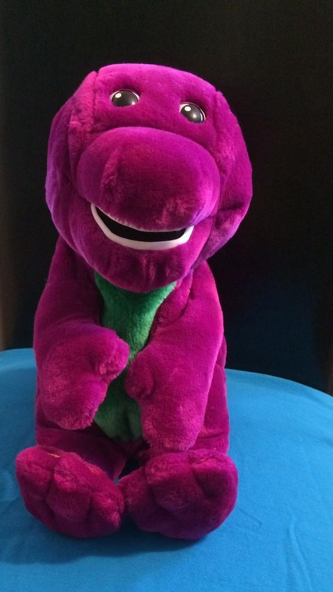

# Bringing Microsoft's ActiMates Barney Back to Life - Part 3: Giving the Bytes a Voice

In the [second post](./2026-11-16-Hacking-Microsoft-Barney-part2.md), I turned captured MIDI traffic into commands and replies. The Pack introduced itself, checksums made sense, and I discovered why yesterday's connection setup did not necessarily work today.

Useful progress. But I still had rather a lot of hexadecimal and rather little dinosaur.

The next question was obvious: **could I recover the speech hidden in those messages?** 🦖



## It is not a tiny WAV file 🎧

My first task was to separate speech from the rest of the conversation. The original software helped again: its routines revealed which commands carried speech and how much data each contained.

One longer recording contained **697 speech frames**:

| Frame type | Source bytes per frame | Count |
| --- | --- | --- |
| Silence | 1 | 92 |
| Unvoiced speech | 5 | 95 |
| Voiced speech | 7 | 510 |

These are the reconstructed speech bytes, not complete MIDI messages. The transport adds its own packing and checksums, as described in part two.

Five or seven bytes is not much room for recorded sound. That was the clue: the PC was not sending ordinary audio samples. It was sending a compact description that a speech synthesizer could turn into sound.

A recipe, rather than a recording of someone cooking.

## A voice made from a buzz and a filter

The likely family was [linear predictive coding](https://en.wikipedia.org/wiki/Linear_predictive_coding), usually shortened to LPC. It is an old speech-coding technique associated with devices such as Texas Instruments' [Speak & Spell](https://en.wikipedia.org/wiki/Speak_%26_Spell_(toy)).

In simple terms, it models speech using:

- **Energy:** how loud the sound should be.
- **Pitch:** the repetition rate for voiced sounds, such as vowels.
- **Filter settings:** how to shape the sound, roughly modelling the vocal tract.

Voiced sounds start from a repeating signal; unvoiced sounds, such as an "s", use noise instead.

These ingredients were familiar from my own English/French Text2Speech synthesizer for .NET nanoFramework: pitch, formants (the resonances that help distinguish vowels), and noise can produce understandable speech without a large neural network. Apparently, building a small speech synthesizer was also preparation for talking to a purple dinosaur.

I explain that side in more detail in [How this tiny Text2Speech synthesizer finds its voice](./2026-10-17-How-this-tiny-Text2Speech-synthesizer-finds-its-voice.md), following text through pronunciation rules to audio samples. My TTS renderer is not an LPC decoder and outputs PCM audio, not Barney's D6 frames: familiar ingredients, but a different recipe.

That is a very simplified explanation. Your vocal tract is considerably more sophisticated than a purple dinosaur's packet format. At least, I hope so 😀.

## The right family is not necessarily the right format 🔍

I investigated TMS5220-style speech and projects such as [Speakie](https://github.com/raphlinus/speakie). They provided useful references, but "it uses LPC" was not enough.

Related speech chips can use different field sizes and different tables for converting encoded values into actual synthesis parameters.

The important lead came from the [Texas Instruments speech synthesizer design manual](https://www.ti.com/lit/ml/spss011d/spss011d.pdf). Its **D6 format** matched the sizes I had recovered from the original software:

```text
Unvoiced frame: 34 meaningful bits -> fits in 5 bytes
Voiced frame:   55 meaningful bits -> fits in 7 bytes
```

That was promising, not conclusive. Plenty of wrong explanations fit inside a byte array. Ho, and I had to try quite a few but again, going back to 1996 helped a bit 😉.

## Which end of the byte comes first?

There was another small detail with large consequences: **bit order**.

I compared reading each source byte from its least significant bit first against reading it the other way around. I also compared D6 and TMS5220 layouts.

The unused bits at the end of each frame became particularly useful. With the right interpretation, the meaningful fields should fit and the remaining padding should be zero.

Here is what happened across the 697 frames:

| Interpretation | Frames with nonzero unused bits |
| --- | --- |
| D6, least significant bit first | **0** |
| D6, most significant bit first | 475 |
| TMS5220, least significant bit first | 600 |

D6 with least-significant-bit-first reading also matched the expected frame types throughout.

That is a much stronger result than "this one makes a vaguely dinosaur-shaped noise". ✅

One trap: each speech packet starts a new byte-aligned frame. Concatenating all the bytes and feeding them blindly into a continuous decoder would also feed the padding into it.

The packing problem from part two had acquired a smaller, equally annoying cousin.

## Building something I could actually hear 🛠️

I wrote a C# experiment tool, **SpeechLab**, to connect the pieces:

```text
Captured MIDI conversation
        |
        v
Validate messages and extract speech frames
        |
        v
Decode D6 energy, pitch and filter settings
        |
        v
Synthesize audio samples
        |
        v
Write a playable WAV file
```

I compared several combinations rather than trusting the first playable result: format, bit order, playback timing and the signal used to excite the filter.

A useful starting point was **10,000 audio samples per second and 20 milliseconds per frame**. That is a synthesis setting for the experiment, not proof of the toy's exact internal clock.

The tool also kept diagnostics alongside the audio. A media player accepting a WAV file proves that I wrote a WAV file. It does not prove that I decoded Barney correctly.

Also: start at low volume. Experimental speech synthesis can occasionally sound like a modem having a difficult afternoon. Been there with my TTS!

## Finally, recognisable words 🎉

Then came the rewarding part: I could hear recognisable speech from the capture.

🎧 **[Listen to the first decoded speech capture (WAV)](../assets/d6-lsb-10000hz-20ms-chirp.wav)**. This is a software reconstruction of the captured speech stream, not a microphone recording of Barney.

As a second opinion, I ran speech recognition locally on several decoded variants. Consistent phrases included:

> "What a good choice!"
>
> "One, two, three, four."

Not every word was clear, and automated transcription was not an authoritative script. But agreement between the packet structure, the decoded parameters, listening and several transcription results was much better evidence than any one of them alone.

There were still limits. My synthesizer approximated the speech-generation process; it did not reproduce every detail of the original chip. Recognisable speech does not mean a bit-perfect recreation of Barney's voice.

Nevertheless, bytes captured from a 1990s game-port cable were now producing understandable words on a modern PC.

That deserved a small celebration. Possibly not a song (if I sing, it will definitely rain). There had already been quite enough singing.

## Next: making Barney say something new 🗣️

So far, I had recovered speech that the original software sent. I had **not** turned arbitrary text into new sentences for the toy.

That is the challenge in the next post: going in the other direction, from text to audio, from audio to D6 frames, and through the original Pack to Barney.

Decoding a dinosaur is one thing. Persuading him to read my own sentences is where things get really interesting.
